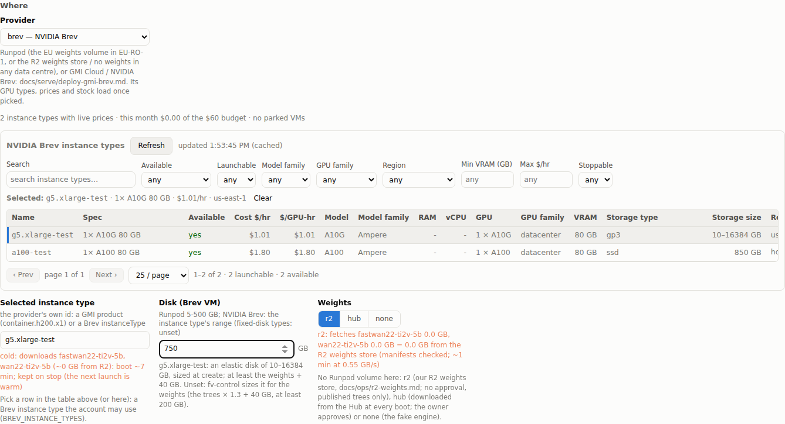

# Standalone pods

Status: built 2026-10-06 (branch `feat/standalone-pods`), not deployed yet.
Code: `control/src/standalone.ts`, the routes in `control/src/index.ts`,
`control/public/standalone.js`, `scripts/serve/fv-control.sh pod …`.

A standalone pod is one fv-serve pod launched on its own, not as part of a
cluster: one GPU (or CPU) worker from a variant and an image, in a region,
with a deadline, which the owner can stop, start and delete.

## Design: a one-pool direct cluster

A standalone pod is stored as a cluster row with
`clusters.source = 'standalone'`. Its spec has one pool, `pod`, with
`count: 1`, and `control_plane: "direct"`. Everything a cluster pod goes
through, it goes through by the same code, not a copy:

| concern | how a standalone pod gets it |
|---|---|
| validation | `normalizeSpec` (the cluster spec schema), after `standaloneSpec` turns the launch request into a spec |
| create | the ClusterOps `up` operation: price check against the floor, image preflight (`cluster/preflight.ts`), placement (`workerPlacements`), payload (`workerCreatePayload`), the `max_gpu_dph` cap, wait until ready with the early verdict (`cluster/upwait.ts`) |
| stop / delete | the `down` operation (delete, verify, retry); delete with a pod passes `delete_definition`, and the definition goes once the pod is gone |
| deadline | the cron's deadline backstop (`collector.ts`), and the pod's own watchdog: `WATCHDOG_WORKER_BOOT` (the edge fronts' watchdog on a direct worker), with `FV_CLUSTER_DEADLINE`, `FV_MIN_BALANCE`, `FV_BACKSTOP_API_KEY` |
| balance floor | the cron's floor rule stops it like any cluster; the price check refuses a start under the floor |
| idle stop | `idle_stop_min` (the spec's `auto_stop_idle_min`): after that many idle minutes the cron stops it (a cluster drains one worker instead; a standalone pod has nothing to drain to) |
| costs | `cost_daily` and every spend view, owner `pod:<name>`, `cluster_id` = its id |
| logs | log shipping with its own ingest token, and the Runpod container / system log captured from boot (`podlogs.ts`) |
| boot timeline | `cluster_pods.boot` (`boottime.ts`), like every controller pod |
| env | the launch's `env` is stored at the definition's cluster level (it survives stop / start); the Env page and `/api/env/cluster/<id>` edit it; reserved keys are refused |
| admin token, keys | the direct-cluster routes (`/api/clusters/<id>/admin-token`, `mint-key`, `keys`) work on its id |
| audit | `standalone.launch`, `.start`, `.stop`, `.extend`, `.delete` (secret env values masked) |

Stop deletes the pod rather than pausing it: a GPU pod with a network volume
cannot be paused on Runpod, and a deleted pod costs nothing. The definition,
its env, logs, timeline and costs stay; start makes a new pod.

A standalone pod is direct only. An edge front needs the one edge cluster
that fronts the edge (docs/serve/edge-control-plane.md §10 Q2), so a
standalone pod is not put behind the edge. Its URL is its pod's proxy URL;
`auth: keys` (default) with the controller's admin token, as for a direct
cluster. `scale` past one is refused (400); `roll` and `restart` work.

## API

Mutations need admin (an admin token, or a session with `x-csrf-token` and
a same-origin `Origin`); a read token can list and read.

| route | |
|---|---|
| `POST /api/standalone` | launch; 201 `{pod, operation}`; `start: false` only defines it |
| `GET /api/standalone` | every standalone pod: definition, pod, status, boot diagnosis and timeline, cost today / total, operation |
| `GET /api/standalone/<id or name>` | one |
| `POST …/start {skip_image_check?}`, `POST …/stop`, `POST …/extend {minutes}` | operations (202) |
| `DELETE …` | 200 when it has no pod; else 202, and it is deleted once the pod is gone |
| `GET /api/pods/<pod>/status` | any controller pod: Runpod view, the controller's record, boot diagnosis, boot phase and timeline, cost, log count |
| `GET /api/pods/<pod>/boot` | the boot timeline |
| `GET /api/pods/<pod>/logs?after_id=&source=runpod\|serve\|control&level=&q=&since=&until=&limit=` | log lines, oldest first; `next_after_id` to follow |

The launch request:

```json
{
  "name": "h3-solo",
  "preset": "h3-turbo",              // or "variant" + "config" / "config_toml" + "models" / "fake_models"
  "channel": "latest",               // or "sha", or "image" (a ref or a digest); default: stable
  "compute": "GPU",                  // or "CPU" (+ "cpu_flavors", "vcpu")
  "gpu_types": ["NVIDIA RTX PRO 6000 Blackwell Server Edition"],   // in order: the fallbacks after the first
  "weights_source": "volume",        // volume | r2 | hub (+ "weights_download_approved": true) | none. Default: the preset's (below)
  "region": "eu",                    // or "dc": "EU-RO-1": the weights volume's data centre (CLAUDE.md: EU only)
  "volume": true,                    // the region's weights volume at /workspace (GPU default with the volume)
  "env": {"FOO": "bar", "HF_TOKEN": {"value": "…", "secret": true}},
  "deadline_min": 60,                // 5-10080
  "idle_stop_min": 30,               // optional
  "max_gpu_dph": 3.6,
  "start": true
}
```

## CLI

```bash
fv-control.sh pod launch h3-solo --preset h3-turbo --channel latest --deadline-min 45 --wait
fv-control.sh pod launch fake1 --variant cpu --cpu cpu3c --config /etc/fv/runpod-fake.toml --json extra.json
fv-control.sh pod list | status <name> | stop <name> | start <name> | extend <name> 30 | delete <name> | wait <name>
fv-control.sh pod logs <name | pod id> [--source runpod|serve] [--follow]
fv-control.sh boot <pod id | name>            # the boot timeline
```

`--secret-env K=@FILE` reads a secret value from a file (not argv).

## Weights and data centres (Runpod)

Owner 2026-10-13: "I should be able to launch Runpod in any region if I am
using R2". A Runpod pod reads its weights one of three ways
(`weights_source`):

| weights | where the pod runs | request |
|---|---|---|
| `volume` | EU-RO-1 only: the network volume `bz0ofkfx45` (H3 + LTX trees) is mounted at `/workspace` | `region: "eu"` (or `dc: "EU-RO-1"`) |
| `r2` | any Runpod data centre: the trees come from the R2 weights store onto the container disk at boot (docs/ops/r2-weights.md; published trees only, no approval) | `data_centers: ["US-TX-3", "US-CA-2", "any"]` (or one `dc`) |
| `hub` | any Runpod data centre: the trees from the Hub at their pinned revisions (weights-revisions.tsv) onto the container disk at every boot, with `fetch-hub-tree.py` at the image's commit, as on GMI / Brev. Needs the owner's approval: `weights_download_approved: true` on the launch **and** `FV_HUB_DOWNLOADS_APPROVED=1` on fv-control (CLAUDE.md: large downloads need approval); refused at `weights_download_approved` otherwise | as r2 |
| `none` | any Runpod data centre: no weights (the fake engine) | as r2 |

A CPU pod needs no weights: with `volume` off (its default) it runs in any
data centre too. `data_centers` are tried in order, each with every
`gpu_types` entry in order (data centre first); a last `"any"` sends no
`dataCenterIds`, so Runpod places the pod (with the CUDA 13 host filter of
a data centre without the volume). Unset, the pod runs in EU-RO-1.
With r2 and hub fv-control sizes the container disk from the trees (unset
`container_disk_gb`; at most Runpod's 500 GB, a bigger set is refused); a
network volume is never written.

**NVIDIA Brev disk** (owner 2026-10-18): on provider brev `container_disk_gb`
is the VM's disk ("Disk (Brev VM)" on the launch form and the cluster pool
editor), sent as Brev's `diskStorage` at create and recorded with the VM.
It is checked against the instance type in Brev's list: an elastic type
takes its storage classes' range (e.g. 10–16384 GB), a fixed-disk type
(`850GiB` ssd) only its own size (leave it unset), and every size at least
the trees + 40 GB. Unset, fv-control sizes it (the trees × 1.3 + 40, at
least 200 GB, inside the type's range). A parked VM is reused only when its
disk is at least the size asked for. The pod's page shows the definition's
disk and the VM's disk as created (`pod.brev.disk_gb`). GMI's container disk
is the product's: `container_disk_gb` is refused there.

 The Hub boot (`providers.ts HUB_RUNPOD_SH`,
inserted before fv-serve by `payloads.ts bootFor`) logs each tree, a `step
hub <tree>: <s>` line per tree and `step weights: <s> (Hub)`; a failure
exits after 30 s, Runpod restarts the container and the complete trees are
kept. Cluster pools take the same `weights_source` / `hub_download_approved`
(the cluster page's Weights select). Serverless endpoints have no hub (their
own boot: volume or r2).

The default follows the preset (`presetWeightsDefault`, the same rule as a
cluster pool): the volume when it holds every tree the preset loads (H3,
LTX), else r2 when every tree is published in R2 (wan, fastwan21, sfwan,
longlive, fasth3-trim since the 500 GB EU volume, owner decision
2026-10-13). The launch form preselects it; `GET /api/schemas/dynamic`
lists it per preset (`pool_presets[].weights_source`).

The validator (`POST /api/standalone/validate`), the launch and the image
preflight share one rule (`schemas.ts StandaloneLaunchZ`): a data centre
without the volume (or `"any"`) is refused for a volume pod at its field
("US-TX-3 has no weights volume: weights_source r2 … or none runs in any
data centre"), and so is `volume: true` with r2 / none there. `"any"` may
only come last; `dc` and `data_centers` do not go together.

```bash
fv-control.sh pod launch wan-us --preset wan --weights r2 --region US-TX-3 --gpu "NVIDIA H100 80GB HBM3" --gpu "NVIDIA H200"
fv-control.sh pod launch wan-any --preset wan --weights r2 --dc US-TX-3 --dc any   # data_centers: ["US-TX-3", "any"]
fv-control.sh pod launch wan-hub --preset wan --weights hub --approve-hub-download --dc US-TX-3
```

## GMI Cloud and NVIDIA Brev

`provider: gmi | brev` (`--provider` on the CLI) launches the same pod on a
GMI Cloud container or a Brev VM (docs/serve/deploy-gmi-brev.md): `provider_gpu`
is the provider's product / instance type, there is no weights volume
(`weights_source: none` runs the fake engine; `hub` downloads at boot after
the owner's approval), the pod reports its HTTPS tunnel URL to
`/ingest/v1/endpoint` (a named tunnel fv-control made on the owner's zone,
URL known at create, or a quick tunnel without those settings;
deploy-gmi-brev.md §6.4), and a monthly budget replaces the balance floor:
the form's "Monthly budget" field under Provider (saved for the account,
policy `brev_budget_usd` / `gmi_budget_usd`; unset: the Worker var
`BREV_BUDGET_USD` / `GMI_BUDGET_USD`). The form says a launch over it at the
provider before Launch. "Max GPU $/hr" is a per-pod price cap, not the budget. The launch's
operation log says the budget, not Runpod's balance: a pod with no Runpod
pool logs `NVIDIA Brev: $6.04 spent this month + ~$4.04/hr (this launch
$4.04/hr) for 1.00 h → projected $10.08 at the deadline; budget $100
(within)` and no balance / floor line (`ops.ts projectionLines`; the price
API's `runpod: false` and `budgets[]`, shown by the Start dialog, the
cluster page and the deploy plan). Both are off until the owner
sets their secrets; the form and `fv-control.sh providers` say why.

**Brev keep-on-stop** (docs/serve/deploy-gmi-brev.md §3.4). Stopping a
Brev pod of a stoppable instance type, whose Hub weights completed, stops
the VM instead of deleting it (owner rule 2026-10-11: "stopping a brev vm
should NOT delete it. brev VM's should be re-used or manually deleted"):
it is *parked* with its weights under `~/workspace/weights`, or *held*
with a note when its boot never became ready (a failed boot: partial
weights stay and the next boot resumes them). This covers Stop, the
deadline, the idle stop and a budget stop. `fv-control.sh pod delete
<name>` of a pod whose VM is live deletes that VM (your explicit delete);
the delete of a definition with no pod leaves any parked VM alone. The
next launch of the same instance type reuses a parked or held instance
before creating one: a *warm* boot when it holds the trees, else the
trees download onto it.

A stop that does not succeed deletes the VM instead (owner rule
2026-10-13: "We should go ahead and delete VMs that need to be stopped if
a stop command does not succeed. If the stop command succeeds then we
should NOT delete the VM."): Brev refuses it, another stop error persists
over 3 tries, or the VM is not STOPPED 10 minutes (`BREV_STOP_TIMEOUT_S`)
after a stop Brev accepted. The record says `stop failed (<reason>):
deleted`, its tunnel goes, and the info alert `brev_stop_deleted` names
it. A pod stopped while its VM is still DEPLOYING is `stop_pending`: the
cron stops it once it leaves DEPLOYING, or deletes it after 15 minutes.

Non-stoppable types (e.g. `massedcompute_*`) are launched like any other
(owner decision 2026-10-13). Brev cannot stop them (a stop answers HTTP
500 "does not support stop"), so every stop of such a pod deletes its VM,
with its disk and weights: it ends at its deadline like any pod and its
next launch downloads its weights again.

A parked instance bills storage only. That cost counts in the Brev
budget and the cost views (owner `brev:parked`); the policies
`brev_park_max` (2) and `brev_park_max_days` (7) only raise the alert
`brev_parked_over_limit`. A restart that fails or does not
come up is *held* (reused by a later launch after 15 minutes, or at once
after Unpark), and another instance or a fresh pod is used. A restart
Brev cannot run for capacity (its start task says InsufficientCapacity;
shown in the launch log) gets 3 more starts over about 5 minutes; then the
VM stays parked (not deleted) and a fresh pod is created.

The launch form lists the stoppable instance types first, then the others
with "WARNING: can't be stopped: a stop deletes it (its disk and weights go too)", and shows "warm:
restarts parked …" or "cold: downloads … (~N GB): boot ~M min" at the
instance-type field. The Pods page lists parked and held instances with
their weights, disk, $/day and reuse status, with Delete (yours only) and
Unpark for a held one. The Stop confirmation of a Brev pod says its VM is
stopped and kept, with its storage $/day.

```bash
fv-control.sh brev parked                    # policy line; parked / held instances: weights, disk, $/day, reuse
fv-control.sh brev unpark <workspace id>     # a held one reusable at once
fv-control.sh brev delete-parked <workspace id>
```

```bash
fv-control.sh providers
fv-control.sh pod launch smoke-gmi --provider gmi --gpu container.h200.x1 --fake --deadline-min 20 --wait
fv-control.sh pod launch smoke-brev --provider brev --gpu <instanceType> --fake --deadline-min 20 --wait
```

## UI

The **Standalone** page (`#/standalone`, `public/standalone.js`): the list
with status, boot phase, pod, image, GPU, DC, $/hr, cost today and total,
deadline, and Start / Stop / Extend / Delete; a launch form (preset or custom
variant, image source, compute, the GPU table, weights, region or data
centres, volume, deadline, idle stop, env). `#/standalone?id=<name>` shows one pod: its pod and definition,
cost, the boot timeline, the last operation's log and the last 40 log lines,
with a link to the Logs page.

The form's GPU / instance type is picked from a table of every type the
chosen provider lists. For Runpod this is each GPU type per data centre with
its stock; for Brev, every instance type of the org; for GMI, every
product. The columns are name, spec, available, cost ($/hr and $/GPU-hr),
model, model family, RAM, vCPU, GPU, GPU family, VRAM, storage type and
size, region, launchable, and on Brev also stoppable and deploy time. The
table sorts, searches, filters and pages. A click on a launchable row fills
the form: `gpu_types` and `region` (volume) or `data_centers` (r2 / none)
on Runpod, `provider_gpu` on Brev, `provider_gpu` and `provider_region` on
GMI. A row fv-control cannot launch says why.

On Runpod the form's **Weights** (volume, r2, hub, none; the preset's
default first; hub shows the owner's approval box) decide the location and which rows are launchable: with the volume,
the region (EU-RO-1) and the volume toggle; with r2 or none, a **Data
centres** pick of every data centre Runpod lists (its location and the
picked GPUs' stock), fv-control's other ones, and "any", in order. Switching
the weights recomputes the table's launchable column at once (no refetch).
The GPU pick is the table: a click picks the primary, **+ fallback** (or
Shift+click / Shift+Enter) appends, and the **Selected GPUs** strip orders
and removes them (README.md, "Instance types"). The table loads when the provider is picked and on its Refresh
button, which reads the provider again (at most once per 30 s). The
endpoint and the column definitions are in README.md, "Instance types".
The page adds its own route to the dashboard's
router; the shared files only gain a nav link and a script tag
(`index.html`), and the pod page one line for the boot timeline card.

## Tests

`control/test/unit/launch-any-dc.test.ts` (r2 / none in any data centre:
the request shape, placements and payload, the fallbacks' order, "any", the
refusals the validator and the preflight share), `control/test/unit/hub-runpod.test.ts`
(hub: the approvals, the env and disk, the boot's weights step in bash with
a stub fetcher), the integration steps "standalone Runpod pod with
weights_source r2 / hub in a data centre without the weights volume", `control/test/unit/standalone.test.ts` (spec building and refusals, payload
and watchdog boot, the routes with auth and CSRF, delete with and without a
pod, pod status and logs JSON), the integration step "standalone pod" (the
real Durable Object: launch, up, the watchdog boot, owner `pod:<name>`,
status, boot timeline, logs, stop, start, delete), and the UI smoke (launch
from the form, the pod's page, phone width), `test/unit/instance-types.test.ts`
and `test/ui/instance-tables.mjs` (the launch form's instance-type tables).
